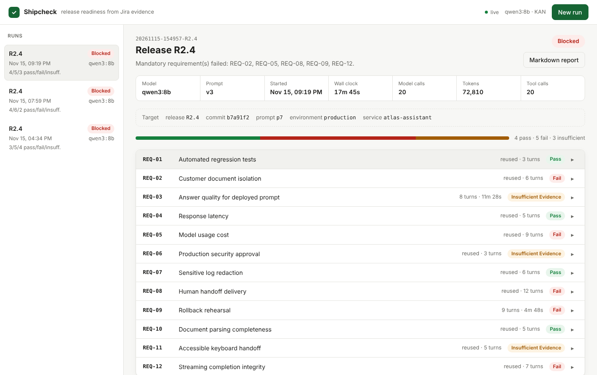

# Shipcheck

An AI agent that reads Jira and decides whether a release is ready to ship. For each requirement it gathers evidence through tools and decides `PASS`, `FAIL` or `INSUFFICIENT_EVIDENCE`; the overall decision is `BLOCKED`, `NEEDS_REVIEW` or `READY`.

- The model chooses what to look at through **read-only Jira tools**; it never sees the dataset file.
- **Code checks what the model claims:** every citation must be something the agent actually fetched, linked records must be read before deciding, and a result on another build or prompt cannot support a decision.
- The overall decision is computed **in code**. Every run is **bounded, traced, measured and resumable**.

TypeScript · Node.js 22 · no agent framework · any OpenAI-compatible model (Ollama, Gemini, OpenAI, …) · Jira Cloud REST v3 · CLI, plus an optional web UI.



## Result

**Release R2.4: BLOCKED.** 4 pass, 5 fail, 3 insufficient evidence. Final report: [`runs/20261115-154957-R2.4/report.md`](runs/20261115-154957-R2.4/report.md), with the trace, each investigation's transcript and metrics in the same folder. Produced with `qwen3:8b` running locally (126 model calls in total, $0). The decisions, how the report was produced over three runs, and what changed along the way are in **[docs/RESULTS.md](docs/RESULTS.md)**. The import was verified against the dataset with no mismatches ([`artifacts/import/verify-report.json`](artifacts/import/verify-report.json)).

## Quick start

**Needs:** Node.js 22+, a free Jira Cloud site, and a model endpoint (Ollama locally, or a free Gemini key).

```bash
npm install
cp .env.example .env          # Jira and model settings
npm run check                 # typecheck, lint, format, 90 tests (no network)
```

**1. Jira.** Create a free site and a project (any key), and an API token at <https://id.atlassian.com/manage-profile/security/api-tokens>. Set `JIRA_BASE_URL`, `JIRA_EMAIL`, `JIRA_API_TOKEN`, `JIRA_PROJECT_KEY`.

```bash
npm run verify-jira           # checks credentials and project
npm run import                # 400 issues, 2,059 comments, links, statuses (safe to rerun)
npm run verify-import         # diffs Jira against the dataset
```

**2. Model.** Any OpenAI-compatible endpoint (`LLM_BASE_URL`, `LLM_MODEL`, `LLM_API_KEY`). For a local model on Windows: `npm run setup:ollama` installs Ollama, pulls `qwen3:8b` and updates `.env`. Check with `npm run verify-llm`.

**3. Assess.**

```bash
npm run assess                          # full assessment (release, project, label from .env)
npm run assess -- --only REQ-04         # quick demo on one requirement (not a release decision)
npm run assess -- --resume runs/<id>    # continue a run; finished requirements are reused
npm run ui                              # optional: web UI on http://127.0.0.1:4000
```

A local 8B model takes about 40 s per turn, so a full run is roughly an hour; keep the machine awake. A hosted model is much faster and needs only a configuration change.

## How it works

```
Discovery agent ─▶ manifest (code) ─▶ one investigator agent per requirement ─▶ overall decision (code) ─▶ report
```

The agent uses five tools: `search_issues`, `get_issue`, `get_comments`, `check_scope` (compares a result's release, commit, service, environment and prompt with the target) and `record_decision` (validated before it is accepted). Details, decisions and limitations: **[docs/DESIGN.md](docs/DESIGN.md)**. Results and what changed between runs: **[docs/RESULTS.md](docs/RESULTS.md)**. How AI tools were used: [docs/ai-assistance.md](docs/ai-assistance.md).

## Repository

```
packages/core/   agent (loop, orchestrator, prompts), tools, Jira client, importer, LLM adapter, report
apps/cli/        commands: verify-jira, import, verify-import, verify-llm, assess, evaluate
apps/server/     Fastify API + Socket.io (optional UI backend)
apps/web/        React UI
runs/            submitted runs: report.md, report.json, trace.jsonl, transcripts/, metrics.json
artifacts/       import report and verification
```
