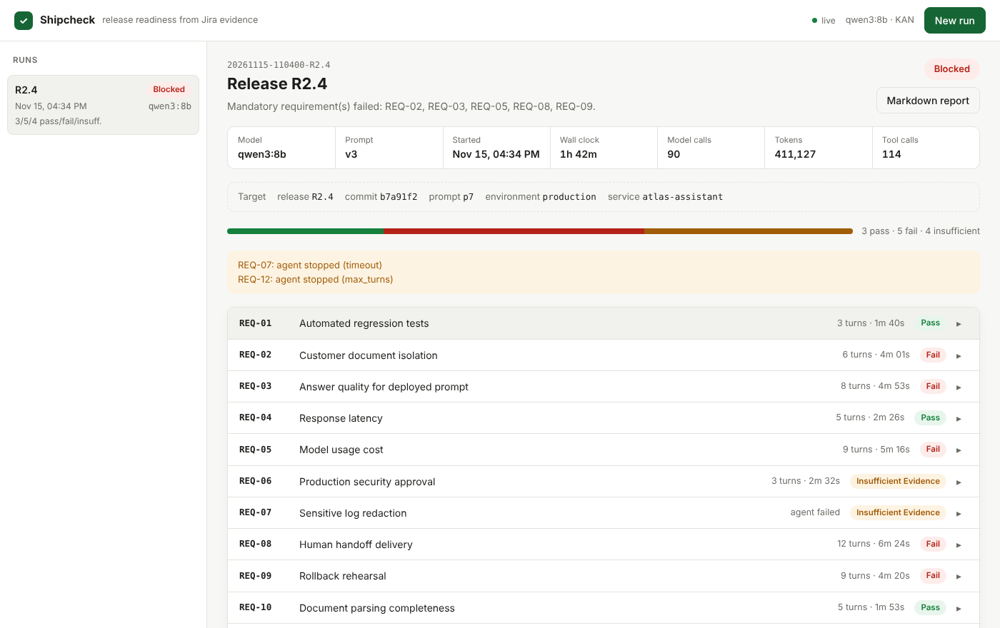
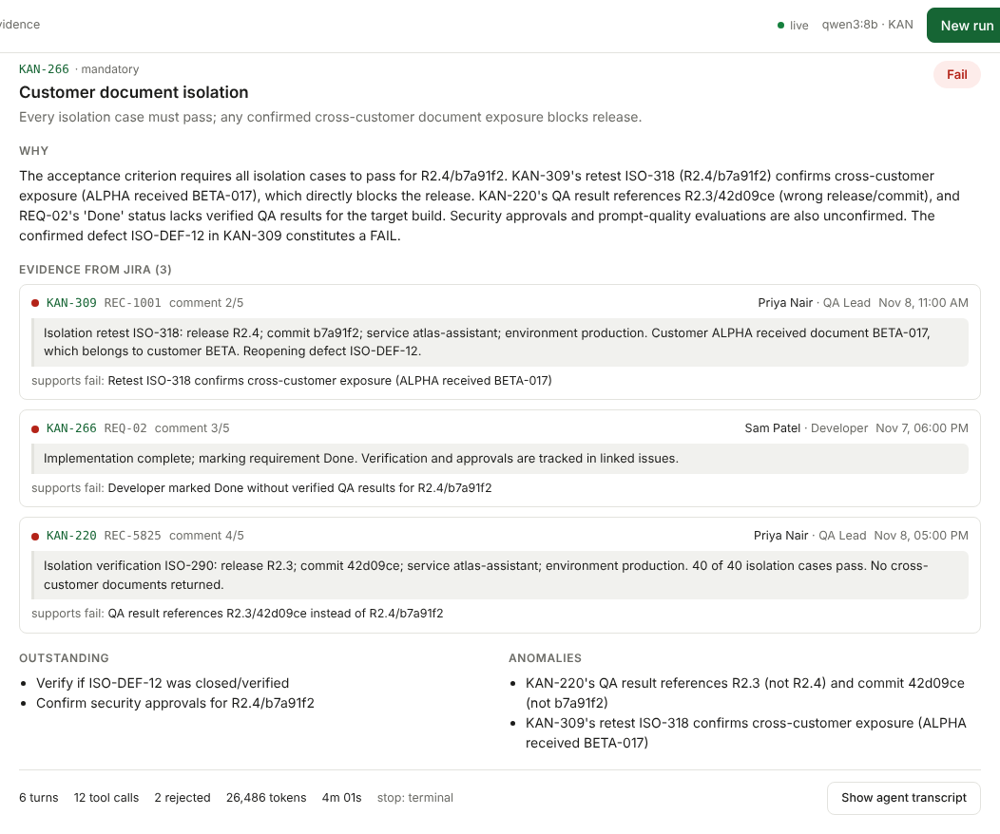
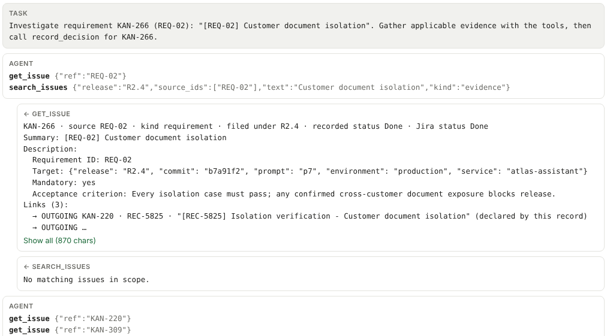

# Module 17: Web UI (bonus)

**Status:** built · checked in a browser (light and dark)

**Code:** `apps/web/src/` (`App.tsx`, `components/`, `api.ts`, `useLive.ts`, `styles.css`)

## 1. Purpose

A reviewer-friendly view of the same run folders the CLI writes: the overall decision, each requirement's reasoning and the Jira evidence behind it, the agent's own tool calls, and live progress while a run is going.

```bash
npm run ui          # build + serve on http://127.0.0.1:4000
npm run web:dev     # Vite dev server on :5173 with hot reload (proxies /api and Socket.io to :4000)
```



## 2. What it shows

| View               | Content                                                                                                                                                                                                            |
| ------------------ | ------------------------------------------------------------------------------------------------------------------------------------------------------------------------------------------------------------------ |
| Run list           | Every run folder, newest first: release, overall decision, pass/fail/insufficient counts, model; marks running, incomplete and partial (`--only`) runs                                                             |
| Run overview       | Overall decision and the rule's reason; model, prompt version, wall-clock time, model calls, tokens, tool calls; the target from the manifest; counts bar; run issues (agent stops)                                |
| Requirement detail | Criterion, mandatory flag, the model's explanation, **evidence quoted from Jira** (issue link, source ID, comment position, actor, role, recorded time, stance, reason), outstanding items, anomalies, agent stats |
| Agent transcript   | The task, each tool call the model chose with its arguments, and what the tool returned (long results collapsed)                                                                                                   |
| Live run           | Phases (preflight → discovery → investigation → report), progress n/12 with ETA, decisions as they land, and a short log of tool calls, rejections and retries                                                     |
| New run            | Full run or selected requirements only (same as `--only`, clearly labelled as not a release decision); disabled with the missing `.env` keys listed when config is incomplete                                      |





## 3. Options considered

| Option                                | For                                                                     | Against                                                                 |
| ------------------------------------- | ----------------------------------------------------------------------- | ----------------------------------------------------------------------- |
| **React + Vite, plain CSS** ✅        | Matches the TypeScript stack; small bundle; no UI kit to learn or theme | Hand-written styles                                                     |
| React + component library (MUI, etc.) | Ready-made widgets                                                      | Heavy for six views; generic look; more dependencies to pin             |
| Next.js                               | Routing and SSR                                                         | Needs its own server; the API already exists in Fastify                 |
| TanStack Query for data fetching      | Caching, retries, polling                                               | Three endpoints and one poll; a small hook is enough. Easy to add later |
| Render `report.md` only               | Zero UI code                                                            | No live progress, no transcripts, no evidence drill-down                |

## 4. Design notes

- **Types are shared, code is not.** The UI imports the backend's types (`RunDetail`, `RequirementResult`, `EvidenceItem`, `Msg`) as type-only imports, so the browser bundle contains no server code but the shapes cannot drift.
- **Same data as the report.** Evidence lines come from the report's ledger-enriched evidence (Jira data), not from model text; only the explanation is the model's.
- **Live state from trace events.** The live panel derives phases, progress and ETA from the same trace events the CLI prints. A page opened mid-run receives the run's earlier events (`run:replay`), so it shows the whole picture.
- **API client on axios**, like the Jira client, with an interceptor that surfaces the server's error message.
- **URL keeps the selection** (`#/runs/<id>`), so a link or refresh opens the same run.
- **Colour carries meaning only:** green pass/ready, red fail/blocked, amber insufficient/needs review. Neutral surfaces otherwise; follows the system light/dark setting; respects reduced motion.
- **Accessibility basics:** buttons for interactive rows, `aria-live` on the live panel, labelled dialog, keyboard-reachable controls.

## 5. Failure modes

| Situation                                               | What the UI does                                                         |
| ------------------------------------------------------- | ------------------------------------------------------------------------ |
| Server not reachable                                    | Banner with the error; "offline" indicator in the top bar                |
| Missing Jira/LLM settings                               | New run disabled; the missing `.env` keys are listed                     |
| Run already in progress                                 | New run disabled ("Run in progress"); the server would answer `409`      |
| Run failed                                              | Banner with the reason; saved results remain visible; **Resume** offered |
| Interrupted run                                         | Marked incomplete; results so far shown; **Resume** offered              |
| No transcript for a requirement (e.g. reused on resume) | "No transcript saved" instead of an error                                |

## 6. Testing

The server API and live events are covered by automated tests (Module 16). The UI was typechecked, linted, built, and checked in a headless browser against a real run folder in light and dark mode, including the evidence drill-down, the transcript, the new-run dialog, and the live panel (with a simulated run that emitted trace events, including a page opened mid-run).

## 7. Likely questions

**Can the UI change Jira?** No. It reads run folders and can start a run; runs use the same read-only agent tools as the CLI.

**Why no component tests?** Time went to the agent's correctness. The UI holds no decision logic (it renders saved results), and the API it depends on is tested. Component tests with Testing Library would be the next step.
